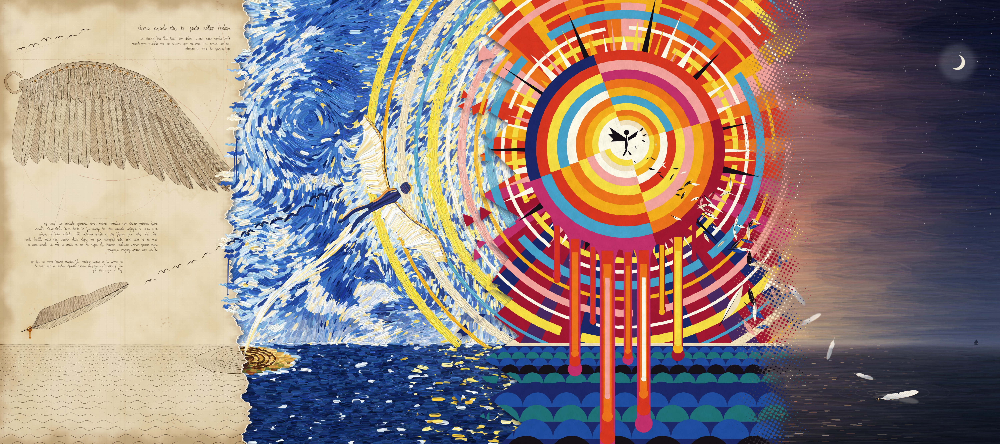

# ICARUS, IN FOUR HANDS — the panorama

The second version of the carousel. It uses the same four painters and the same
story, but the four slides are now **one continuous picture**, 36:16 overall, cut
into four 9:16 slides. Swiping moves you along a single landscape, and the
painting style changes as you go.



## One world

These elements run across all four slides:

- **The sea line** sits at the same height everywhere. It is drawn in ink, then
  laid on in impasto, then cut into gouache scallops, then glazed as dusk water.
- **The flight path** is one curve: up from the labyrinth, through the blue sky,
  into the centre of the sun, and down to the water.
- **The light** moves from a morning page, to a blue day, to the noon blaze, to
  dusk and then night, with a crescent moon and a ship's lamp at the far end.

## Where the painters meet

| Seam | How it joins |
|---|---|
| **I → II** | The notebook page is **torn** and lies over the wet oil painting, casting a shadow. The labyrinth island sits on the tear: one half is in ink and the other in oil, and their walls line up exactly. The ink birds fly off the page and become painted birds. Blue paint has spilled across the tear and runs down the paper. |
| **II → III** | The sun's halo rings are thick impasto in II. They run straight across a **shatter line** and become hard-edged gouache rings in III. Shards of the geometric painting have broken off and lie scattered over the impasto. |
| **III → IV** | The geometry **dissolves into halftone**. The flat colour breaks into dots that shrink to nothing as dusk takes over. The sunburst's hard wedges carry on as soft shafts of light, and the paper-cut feather shards become real feathers falling to the water. |

## Files

`output/`:

- `01-the-design.png` … `04-the-sea.png`: the slides at 2160×3840, in order
- `*-1080x1920.png`: the same slides at standard carousel size
- `00-panorama.jpg`: the whole picture in one image
- `00-slides-overview.jpg`: the four slides side by side

## How it's made

All of it is code. `src/scene.js` holds the shared geometry: the sea line, the
sun, the flight path, the tear, the halo rings, the labyrinth and the flock.
Each painter has its own file (`world-paper.js`, `world-oil.js`, `world-geo.js`,
`world-tonal.js`) and paints its stretch of the panorama onto its own layer.
`panorama.js` stacks the layers and builds the three seams. The painting code
is adapted from v1 (`../src`), which is left unchanged.

```bash
node render.mjs --w=2160     # --w is the width of ONE slide; add --preview for a quick look
python3 contact_sheet.py
```
